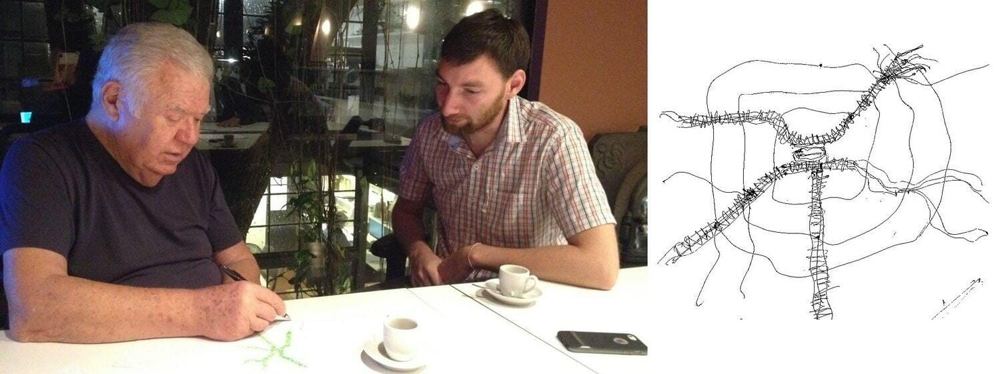
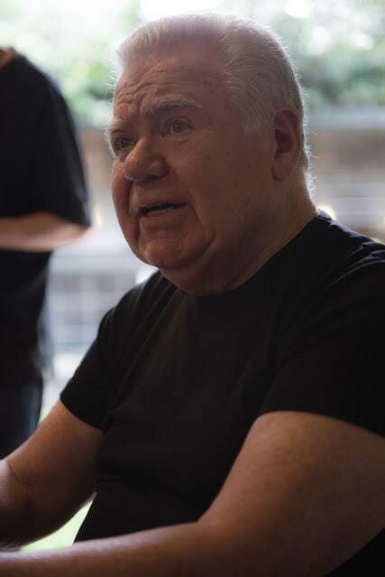
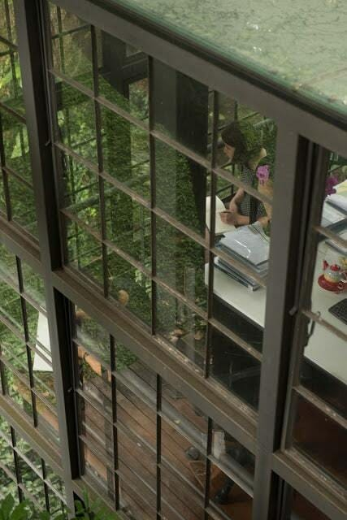
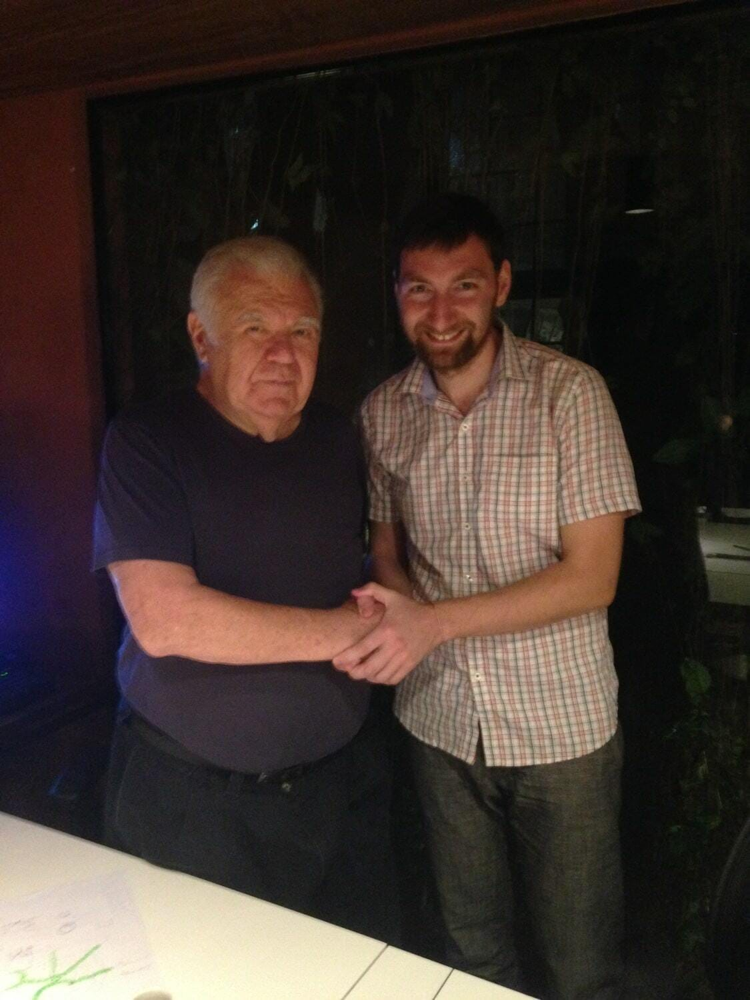
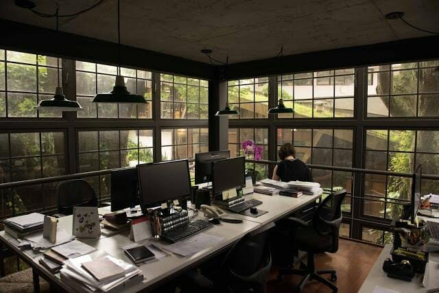

Жайме Лернер — архитектор бразильского города Куритиба и живая легенда для всех, кто занимается городским планированием. За три года он сделал в городе то, на что другим мэрам требуется 30 лет.

Куритибу называют «зеленой столицей» Бразилии и «самым зеленым» городом мира, где нет пробок, мусора и бедности.

Урбанист Михаил Векленко встретился с Жайме Лернером в его мастерской в Куритибе.

Впервые я приехал в Бразилию в апреле 2016 года, после Сан-Паулу — экономического центра страны — мне посчастливилось попасть в известный на весь мир город Куритиба. Своего рода Мекка транспортников, всех тех, кто ищет новые решения для мобильности городов. Город, который подтвердил в жизни выражение, что успех это когда готовность встречается с возможностью. В 1971 году его мэром стал архитектор Жайме Лернер. Он предложил инновационные решения и благодаря удачной политической и экономической ситуации смог их реализовать.

В своей незапланированной поездке в Куритибу я даже не мечтал встретиться с Жайме лично, но, узнав от друзей, что мастерская легендарного архитектора находится в паре кварталов, понял, что нельзя упускать такую возможность. Мастерская — это два небольших здания на базе частного дома, в районе с малоэтажной застройкой. Зеленый двор и два уютных строения с просторными интерьерами и  мастерская, где трудится команда архитектора Лернера. Кстати, рядом с мастерской расположен бар, где часто отдыхает Жайме и где есть его личный стол. Это одна из забавных городских историй. Это не тот стол, который выделили бывшему мэру и губернатору, это стол, который Лернер сам притащил в бар, именно поэтому он всегда зарезервирован для него.

Мой друг Габриель позвонил в мастерскую и договорился о встречи на 18:00 вечера. Этим вечером шел дождь, мы встретились дома и вместе поехали к офису Жайме Лернера. Около одного часа мне удалось пообщаться с одним из легендарных людей современной урбанистики.

Ж. Л.: Здравствуйте!

М. В.: Здравствуйте!

Ж. Л.: Итак, вы работаете планировщиком?

М. В.: Не совсем. Я не планировщик и не архитектор; по первому образованию я экономист, продолжил обучение в сфере городского и территориального управления в Москве в Шанинке по программе университета Манчестера. Основной мой опыт – в урбанистике; мы создали общественную организацию Urban Factory в моем родном городе и начали продвигать проекты по развитию Ростова-на-Дону в различных сферах: транспорт, архитектура, историческое наследие, общественные пространства, развитие промышленных территорий, медиа проекты.

Ж. Л.: Я много раз бывал в России. В Москве, Перми, Санкт-Петербурге. Я очень люблю Петербург и счастлив, что поездка выпала не на холодный период времени. Я провел прекрасное время в вашей стране и планирую снова посетить Петербург. Я все еще много путешествую, несмотря на возраст. Это уже не так легко, но я не переживаю из-за самолетов. Проблема не в самолетах, проблема – в аэропортах. Самый худший аэропорт в мире – в Сан-Паулу. У меня особо нет выбора, так как я всегда вылетаю из Сан-Паулу, когда путешествую. Я могу воспользоваться аэропортом в Рио, но из Куритибы проще летать через Сан-Паулу. Это один большой шоппинг центр, а не аэропорт, там мало места и огромные расстояния. Я ненавижу Сан-Паулу.

> Раньше город был местом авангарда, но это время прошло. Проблема в том, что сейчас там нет, скажем так, «умной жизни». Люди не любят свой город.

М. В.: Но ведь Сан-Паулу не так плох? Конечно, он организован не настолько хорошо, как Куритиба, но все же…

Ж. Л.: Раньше город был местом авангарда, но это время прошло. Проблема в том, что сейчас там нет, скажем так, «умной жизни». Люди не любят свой город. В то же время в Рио люди любят город, там таксисты знают все! А в Сан-Паулу люди не знают город и не любят его. Они проводят огромное количество времени в пробках. Наш офис сейчас работает над проектом агломерации в Рио. В городе двадцать один муниципалитет, а это значит: много работы, бумаг и бюрократии.

М. В.: Это своего рода применение опыта Куритиба или что-то совершенное иное?

Ж. Л.: Совершенно иное. Я думаю, когда мы говорим о мобильности, то ссылаемся на Куритибу, потому что это первый город в мире, реализовавший систему скоростных автобусов. Сейчас эта система применяется в 250 городах по всему миру. Далее этот эксперимент поставили в Боготе, столице Колумбии, где мэр Энрике Пеньялоса проделал очень хорошую работу. Затем то же произошло в Сеуле в Корее, Стамбуле в Турции, Мехико в Мексике, теперь в Рио, во многих городах в Китае и Европе.

М. В.: Разве в Сан-Паулу не пробуют ту же систему?

Ж. Л.: В Сан-Паулу пробуют, но концепция иная. То же самое на северо-востоке Бразилии, в Ресифи. Если в Куритибе 100% выделенные полосы, то и автобусы и в Сан-Паулу, и в Ресифи делят дорожное пространство с автомобилями.

Проблема Сан-Паулу… ты знаешь, этот город сам по себе не настолько сложный, проблема и сложности – в головах людей. Тех людей, которые хотят «продать» город, занимаются недвижимостью, торговлей. Если вы хотите им показать простую идею в Сан-Паулу, то они ее не примут. Это обязательно должно быть сложно, потому что это Сан-Паулу…

М.В.: Звучит так как будто вам не нравится Сан-Паулу?

Ж.Л.: Я ненавижу Сан-Паулу! Когда вы говорите о мобильности, нужно применить несколько очень простых вещей. Во-первых, меньше использовать автомобиль. Но для этого важно иметь хорошую систему общественного транспорта. Во-вторых, жить близко к своей работе. Потому что иначе вы тратите часы на дорогу. Не нужно забывать, что в Сан-Паулу шесть миллионов машин, а каждый автомобиль требует двадцать пять квадратных метров на парковку около дома и столько же — около работы.

М. В.: То есть, если умножить пятьдесят квадратных метров на шесть миллионов, получается, что городу нужно триста миллионов квадратных метров только на парковку…

Ж. Л.: Я бы сказал, что пятьдесят квадратных метров сопоставимы по площади с небольшой квартирой или офисом. Вместо шести миллионов автомобилей можно сделать так, чтобы работа была вблизи дома. Это снизит проблемы транспорта. И такая же ситуация везде, где я выступал и говорил о мобильности. Все совершают ту же самую ошибку, когда спрашивают о новых технологиях, автомобилях без водителей и так далее. Они забывают, что для этих технологий используется уже существующее городское пространство. Концепция «жить рядом с работой» работает намного лучше, чем все самые современные технологии и применение новейших устройств. Эти люди всего лишь используют новые идеи для того, чтобы продавать какие-то свои технологии и продукты.

> Нельзя просто взять и перенести автобусную остановку с одного места в другое, так как это вызывает протест со стороны общественности.

М. В.: Но как вы все это осуществили здесь в Куритибе? Даже став мэром, все равно необходимо пройти через бюрократические препоны. Недостаточно просто иметь хорошую идею по созданию транспортной системы, нужно просчитать и экономику.

Ж. Л.: Я не помню. Я слишком стар, это было очень давно. Все, что я помню — это было очень сложно. Нельзя просто взять и перенести автобусную остановку с одного места в другое, так как это вызывает протест со стороны общественности. Ну а чтобы совершить эти изменения во всех системах города… Вы можете представить, насколько сложно это было и сколько сопротивления мы встретили.

М. В.: Верите ли Вы в то, что в то время политическое единство давало определенные плюсы для реализации Ваших идей?

Ж. Л.: Нет. В то время у мэров было очень слабое влияние. Я был назначен впервые и это означало, что меня могли попросить снять полномочия на следующей же неделе. Поэтому мы должны были работать очень быстро. Я часто говорил своей команде: возможно, мы не будем на данных позициях на следующей неделе. Я помню ту ночь, когда мы запустили систему скоростного транспорта. Мы запустились после полуночи, чтобы проверить все ли хорошо работает. И я говорил водителю: посмотри, наверное ты не осознаешь, но то, что ты сейчас начинаешь, скорее всего будет абсолютно новым способом передвижения людей в городах. И теперь, когда я гуляю по городу и встречаю его, он всегда мне сигналит дважды, приветствуя.

М. В.: Как вы чувствуете себя сейчас в эти дни в Куритибе, когда наблюдаете результаты своей работы?

Ж. Л.: Я ушел из политики четырнадцать лет назад, решив, что уже достаточно поработал на этом поле. Работать в своем городе – вот, что делает меня счастливым. Я изменяю то, как люди себя ведут и как чувствуют себя в городе.

М. В.: Люди здесь очень приятные. Вчера, когда мы прилетели в город, водитель такси из аэропорта был настолько счастлив, он просто наслаждался жизнью. Вне зависимости от того, кто он где он и какое положение занимает. Очень веселый, дружелюбный, расслабленный и счастливый. Он по-настоящему наслаждается жизнью без какой-либо особой причины. И так везде, где бы мы не спрашивали, как пройти куда-то, люди очень счастливы.

Ж. Л.: И знаешь почему? — Почему? — Потому что мы русские! (смеется). Я люблю русскую культуру, она очень сентиментальна. Когда я был президентом международного союза архитекторов, я часто посещал многие страны. Нас было полторы тысячи архитекторов, то есть полторы тысячи эго.

М. В.: Мы только что прилетели из Индии. Думаю, вы можете себе представить разницу между хаосом, который творится в городах Индии, особенно в крупных городах, и тем умиротворением и покоем, которое мы наблюдаем сейчас в городах Бразилии. Вы когда-нибудь были в Индии?

Ж. Л.: Да, я был в Мумбаи, очень сложный город. Еще я был на Гоа и в некоторых других местах. Индия сложна своей политической системой, так как мэр не имеет полноценной власти. Там есть городской парламент: такая система пришла к ним в наследство от британцев, потому что все бывшие колонии стараются как можно дальше уйти от централизации власти. Вы можете видеть это и в других странах. Когда Вы взгляните на другие страны, в большинстве своем власть централизованная.

М. В.: И здесь в Бразилии, когда вы — мэр, у вас много власти?

Ж. Л.: Да, полная автономия. Но сейчас в стране ужасное время.

М. В.: Из-за экономического кризиса или импичмента?

Ж. Л.: Из-за всего.

М. В.: Я думаю, что это перманентный кризис. Нам довелось жить в эпоху кризиса. Стоит ли нам тогда придавать этому такое значение?

Ж. Л.: Да, но сейчас все как-то особенно сложно. «Ta Russo», хотя в переводе означает нечто очень сложное. Еще три года назад было значительно лучше. (Выражение «та руссо» означает в прямом переводе «по русски», применяется в речи чтобы показать что-то сложное, запутанное, трудное — прим.)

> Никогда не прекращай делать то, что должен. У тебя должна быть смелость пройти через кризис. Нельзя просто так тратить время во время кризиса.

М. В.:  Не думаете ли вы, что кризис – это время возможностей?

Ж. Л.: Конечно, никогда не прекращай делать то, что должен. У тебя должна быть смелость пройти через кризис. Нельзя просто так тратить время во время кризиса.

М. В.: Но теперь вы чувствуете себя лучше из-за того, что вы вне политики? Или во время кризиса у вас все же есть желание снова вернуться и применить свои навыки?

Ж. Л.:  Нет, я бы хотел помочь, если б мог, но политика стала такой грязной. Я очень своевременно ушел из политики. Есть выражение: “хватит — значит хватит”. Я не сожалею о том, что был политиком, и я счастлив, что мне довелось стать мэром и губернатором. Мэром мне нравилось быть больше, так как это подразумевает близость к людям. Это было лучшее время в моей жизни, я был моложе, но также потому, что работа мэра подразумевает работу напрямую с людьми.

М. В.: Применяет ли сейчас Бразилия опыт Куритибы? Я имею в виду не просто линии скоростных автобусов, а полноценный опыт Куритибы, расходится ли он сейчас по стране?

Ж. Л.: Все сложно из-за бюрократии и политики. И еще потому, что это слишком простое решение. Каждый мэр думает: «раз это так просто, то я должен был догадаться сам. Почему я должен применять эти идеи в своем городе?»… И проблема в том, что все они хотят найти оправдания, почему они не применяют эти решения. И они хотят иметь все ответы. Но ты не можешь быть всегда парнем, который знает все и решает все вопросы. Планирование города – это траектория, где ты должен оставить пространство для людей, которые смогут тебя поправить, если ты делаешь что-то не так. Инновация – это ни что иное, как просто начать действовать. Важно иметь смелость начать, а потом можно уже по чуть-чуть вносить улучшения. Но это всегда история про опыт, получаемый в процессе работы. Мы изучили многое, делая это сами. Мы научились многому в процессе работы. Иногда я очень раздражен, когда я вижу решения и они не применяют их.

> Инновация – это ни что иное, как просто начать действовать.

М. В.:  В Куритибе или за ее пределами?

Ж. Л.: В других городах. Куритиба всегда брала на себя обязательства в применении инноваций. А когда вы перестаете применять инновации,видите, что люди хотят больше и больше, но это еще вполне можно исправить. Не так сложно достичь этого нового качества в системе общественного транспорта. Это не так сложно. Мы работаем над идеями для Куритибы.

М. В.:  То есть вы и сейчас продолжаете работать над идеями для Куритибы?

Ж. Л.: Это не моя работа, но я люблю Куритибу, поэтому в нашем бюро мы продолжаем работать над идеями для города. Я могу всего лишь рекомендовать, ведь я уже не занимаю верховные позиции в администрации. Но знаете, достаточно сложно работать с людьми, которые склонны говорить, что уже не осталось решений. Этот пример применим в Сан-Паулу, где они убеждены, что нет решений для города лучше тех, которые они уже применили. И они очень горды, когда говорят это. Они почти испытывают оргазм, когда говорят, что Сан-Паулу имеет так много решений и уже не осталось других. А ты говоришь, что нет, на самом деле есть решения, они тебе не верят или зачастую просто игнорируют. Потому что им нравится такое положение дел, когда нет решений. Они любят говорить, что Сан-Паулу настолько большой, что для него нет решений.

Транспорт использует колеса на покрышках, но едет по рельсе посередине, и тогда нет необходимости в использовании водителя. Автобус полностью может двигаться самостоятельно по рельсе, но при этом на покрышках. Работает лучше, тише, эффективнее.

М. В.: Вы применили красивый дизайн и хорошо спроектированные станции в форме цилиндра, двери, которые открываются совместно на станции и в автобусе. Системе уже более тридцати лет. Как я понимаю, вы использовали станции с высокой платформой для того, чтобы была более удобна посадка и высадка пассажиров, на одном уровне. Сейчас, когда нам доступны автобусы с низким полом, мы можем применять данную систему уже с иным дизайном станций, не так ли?

Ж. Л.: Да, конечно. Мы использовали форму цилиндра, потому что две станции в форме прямоугольника на улице выглядят, как маленькие дома. А цилиндр выглядит как связь, соединение. Но в новых городах мэры хотят создать свои особые дизайны для городов, поэтому разные города применяют разные формы. Мы, например, спроектировали квадратные станции для Сан-Паулу просто потому, чтобы были какие-то отличия. Мы спроектировали более удобные станции, которые уместны именно для Сан-Паулу. В Куритибе мы спроектировали цилиндр таким образом, что под полом располагается вся инфраструктура, например, кондиционеры. Хотя сейчас в ней нет необходимости, Куритиба стала не таким жарким городом, как раньше. В Рио, например, используют кондиционирование.

М. В.: Хорошо, вот смотрите, например, когда мы делали проекты в моем городе, мы не обладали властью и влиянием, так как общественная организация не имеет никакой силы изначально. Мы начали продвигать определенные решения для города, например, по строительству велосипедных дорожек или расширению трамвайной сети. И когда мне задавали вопросы – «В чем ценность, зачем развивать общественный транспорт и велодорожки?» я всегда пытался объяснить преимущества и то, как это работает. В большинстве же своем и бизнес и власть ориентированы на экономическую эффективность; они не видят экономики в общественном транспорте. Тогда я пояснял, что транспортная система в городе равносильна кровеносной системе в теле человека. Мобильность есть не что иное, как экономика, так как скорость процессов – это ритм города. Это и есть экономическая активность, то есть мобильность напрямую влияет на экономику. Но в итоге  я так и не смог донести эту связь до большинства. Поэтому мой вопрос к вам, могли бы вы поделиться своим опытом и наблюдениями взаимосвязи городского транспорта и экономического развития города?

Ж. Л.: Взаимосвязь повсеместная. Когда экономику отделяют от людей, то любой город, штат или страна сталкивается с катастрофой. Куритиба всегда была примером, структурой – жизнь, работа, передвижение и досуг  — все вместе. В большинстве своем в США они отделяют работу от проживания. У них нет этого ощущения, чувства, и в итоге, когда они сталкиваются с определенной проблемой, они решают только эту проблему, когда другая проблема возникает, они решают только ее. Это американский прагматизм, но в городе концепция очень важна. Поэтому жизнь, работа, передвижение и досуг должны идти параллельно, это очень важно. Потому что, если я спроектирую город Куритиба, то он будет выглядеть вот так. (рисует)

*Жайме Лернер рисует для Михаила Векленко структуру транспортной системы Куритибы*

Вот центр, далее идут интегральные линии, магистральные линии. Важно иметь более качественный общественный транспорт в местах, где плотность населения выше. Уделяя внимание наиболее плотным местам в городе, система может быстро показать свою эффективность.  В Куритибе два миллиона шестьсот тысяч пассажиров в день. В городе проживает 2 миллиона человек и еще 2,5 живут в агломерации. В Лондоне наиболее сложная и наистарейшая система метро обслуживает 3 миллиона человек в день. Это полноценная система, взаимосвязанная, и поэтому то же число больше, так как система подразумевает комфортные пересадки и использование нескольких автобусов за одну поездку. Это не просто коридор, это полноценная система по всему городу. Станции, автобусы. Сейчас мы спроектировали новую систему. На сегодня я считаю, что она самая современная и эффективная. Когда транспорт использует колеса на покрышках, но едет по рельсе посередине, и тогда нет необходимости в использовании водителя. Автобус полностью может двигаться самостоятельно по рельсе, но при этом на покрышках. Работает лучше, тише, эффективнее. Это очень просто. Я думаю, что это станет очень важным в скором будущем, потому что, как только у вас появляется система скоростных автобусов, вы стараетесь ее улучшить. Примеры описанной мной системы уже можно видеть в Париже и Шанхае. То, что вы намерены развивать в вашем городе систему общественного транспорта, основанную на трамвае, – это очень правильно, так как трамвай не является таким затратным, как метрополитен. При этом это более стабильная, надежная система и она может быть максимально автоматизирована.

М. В.: Господин Лернер, это была очень познавательная встреча. Я надеюсь, мы сможем применить ваши рекомендации в нашем городе.

Ж. Л.: Спасибо, мне было приятно пообщаться с вами. Надеюсь, когда-нибудь я смогу посетить ваш город.

*Жайме Лернер*

*Мастерская Жайме Лернера*

*Жайме Лернер и Михаил Векленко после разговора*

*В мастерской, где работает команда Лернера*

## О Жайме Лернере

Жайме Лернер (1937–2021) — бразильский архитектор и градостроитель. Трижды был мэром Куритибы в период с 1971 по 1992 год и дважды избирался губернатором штата Парана (1995–2002). При нем в Куритибе появилась система экспресс-автобусов на выделенных полосах, которую принято считать первой в мире системой скоростного автобусного транспорта (BRT), позднее дополненная узнаваемыми станциями-трубами; город прославился также пешеходными улицами, новыми парками и программами переработки мусора. В 2002–2005 годах Лернер был президентом Международного союза архитекторов (UIA). Он автор книги «Городская акупунктура»; его бюро Jaime Lerner Arquitetos Associados работало над проектами для городов Бразилии и всего мира.
