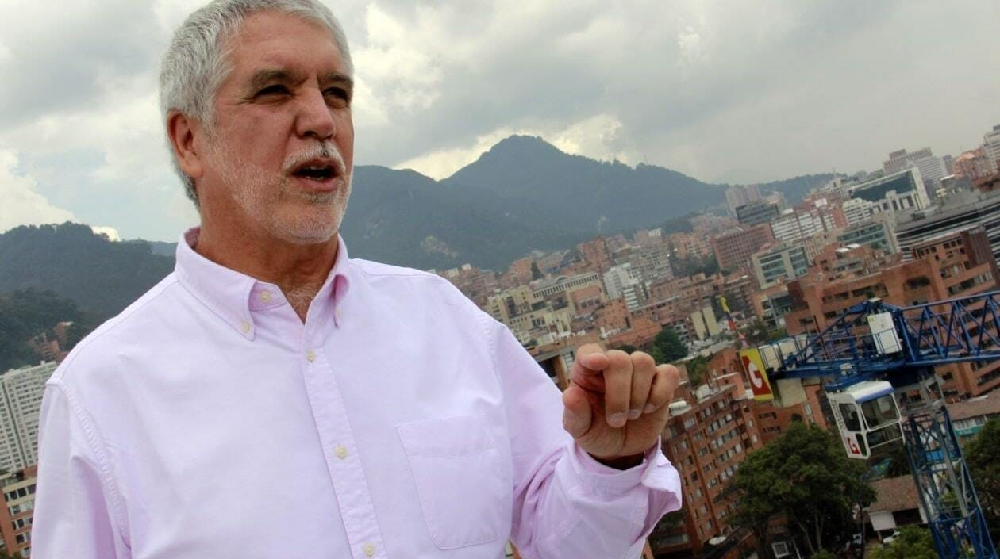
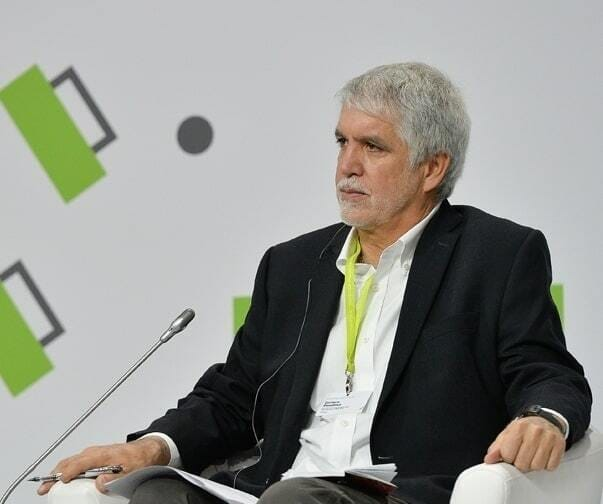

For several years, the Rostov public has been discussing the city's traffic congestion. Rostov urbanist Mihail Veklenko met Enrique Peñalosa, one of the most advanced experts on the transformation of urban environment and transport systems, at the Moscow Urban Forum held in December 2013 and found out how this problem is solved by the world's urban centres.

Enrique Peñalosa, in his three years as mayor of Bogotá, has completely transformed the city and made it convenient for most residents. Instead of building an expensive metro project, investing in motorways and expanding car parks, Peñalosa created pedestrian zones, cycle paths, schools and libraries, and improved parks, squares and embankments. Enrique has managed to reduce traffic in the Colombian capital by 40% - with the help of the TransMilenio public transport system, which is widely regarded as one of the best in the world.

Today, Enrique Peñalosa chairs the board of directors of the New York Institute for Transportation and Development, advises governments in a dozen cities in Asia, Africa, Australia, Latin America, and the United States, and gives speeches and lectures.

## Pedestrian-driver conflict

Now old tram lines are being reconstructed in Rostov. An important context is the active work on the metro project and the city's participation in the 2018 FIFA World Cup. Residents and the city administration recognise the transport problems that are supposed to be solved by the construction of the metro. However, if you look into it, it is an unnecessarily expensive solution that will drag on for many years. The total cost of the first branch of the metro alone is estimated at 75-100 billion roubles. In turn, according to estimates, according to the first stage, the cost of construction by 2018 of the main LRT (Light Rail Transit) lines from the centre of Rostov-on-Don to ZZhM, to SZhM, to the eastern part (Aleksandrovka) and the line to the Left Bank of the Don to the stadium will be 25 billion rubles. This includes the cost of overpasses separating motor traffic from LRT electric train traffic, but without reducing the number of motor vehicle lanes. In addition, the funding can be realised as part of the city's preparations for the 2018 FIFA World Cup. There are a number of comprehensive proposals from the Rostov public to reorganise traffic flows, the options of which are being discussed in the city administration.

- Tell us about your approach to the harmonious development of public transport and how can we use the successful experience of Bogota for Rostov?

- We can't solve traffic problems with rail alone. In Bogotá, residents want a metro: it's fast, underground and not on roads. But what people really want is not the metro, but the qualities it has: speed, convenience, safety. Properly organised surface transport can have a much more positive effect in terms of convenience, speed and accessibility. Buses are a strong symbol of democracy. When a bus with a hundred passengers travels on dedicated lines while cars stand in traffic jams, that is democracy in action. We shouldn't put people underground like rats, because that's horrible.

There are examples where buses are more efficient than trains and trams. In Spain, buses carry more passengers to Madrid every day than two train lines from the same location. A bus can travel close to where you live or work, making it convenient for passengers to board and disembark. The biggest advantage of the bus, however, is that it travels as fast as a train and in most cases passengers do not need to change trains.

- If according to you buses win on many indicators, why do the world's leading cities still prioritise rail transport?

- The reason is simple: the world's first underground was built in the 1860s and 1870s, and buses have been in use since 1935, when they began producing tyres strong enough for that level of load. The problem of traffic jams can be solved not only by adding roads and improving public transport, but also by limiting car traffic. The first solution in this direction in modern cities is to restrict parking in the city centre. Parking is not an individual constitutional right. There is no state where it is not. Just as you decide where to place your belongings and food, you should decide where to park. You don't go to the administration and ask: where do I store my stuff, clothes and food? This is not a technical question, but a political one. Accordingly, it should be a political decision. And you, as citizens of the city, must decide: is your city for motorists or for pedestrians? Will you prioritise widening roads or pavements, will you expand space for cars or for pedestrians?

Prioritising the use of public space is one of the most important and controversial topics in most cities in the world today. This includes the priority of public transport over private transport and the availability of public spaces, parks and recreational areas in the city for people instead of roads and car parks. This conflict is especially visible in developing countries. There is often a real struggle for space in the city between pedestrians and motorists. The existence of this conflict shows that people who walk are third class citizens, while those who drive in cars are first class citizens. In reality, in terms of transport infrastructure, the difference between advanced and backward cities is not at all about having enough roads or subways, but rather depends on the quality of pavements and pedestrian zones.

## Respect for human nature

At the moment buses are not a priority in Rostov. The main transport after cars is small capacity buses (marshrutkas). On one of the main thoroughfares (Krasnoarmeyskaya Street) there are no buses at all, and on streets where there are buses, passengers have to wait at the stop for up to ten minutes while the driver collects passengers. This leads to very uncomfortable conditions and people, of course, prefer faster marshrutkas, which sometimes stop on demand. However, the large number of marshrutkas creates traffic jams on the roads.

- What solutions, in your opinion, can be used to regulate these problems and come to the most efficient operation of the existing transport system?

- You can solve this by changing the system of payment to carriers. Instead of paying for the number of passengers transported, you should pay for the number of kilometres travelled per shift. And, perhaps, only as an additional incentive to pay bonuses for the number of passengers transported. Such a solution would lead to better operation of urban public transport and increase its speed. Another important thing is that the bus system is more flexible and can be reconfigured according to the changes in the city. Routes can be changed and added. It makes sense to combine the existing trams with the new rapid trams you plan to build with a bus rapid transit system.

But don't forget that any transport system is only part of the point. The main thing to realise is that it is vital for people to have urban space to walk around. Recreational spaces in the city are more important than shops and entertainment in shopping centres. Walking and enjoying a stroll around the city is a natural human need. For a social advertising campaign in Bogotá, we came up with this slogan: "Just as birds need to fly, fish need to swim and cubs need to run, people need to walk. The city must respect human nature."

- In another commercial about the fight for pavements for pedestrians, a group of people were playing cards in the middle of a busy road, risking being hit by a car. Tell us what you wanted to show in the context of the balance between transport solutions and the availability of urban spaces in Bogotá?

- The slogan of this advert is: "Just as people should not be in a space for cars, cars should not be in a space for people". Any city that wants its citizens to be happy should have public spaces, boulevards, alleys, bike lanes and walkable pavements. For example, Bogotá is a city with enormous poverty. We have about a million people without their own homes. We have to be very careful about using what little money we have in the budget. It is simply immoral in our case to invest money in metro lines to solve the problem of traffic jams when there are so many other problems in the city: lack of social housing, health issues, education and many other areas of life. For example, Moscow is a rich city and can invest in extensive road and metro construction, and there will still be a profit in the budget.

On the other hand, the state can give residents simple but extremely important benefits that are not available to any corporation. Most of the things the state does are necessities. Parks and public spaces just make you happy. That's the miracle of public spaces and pedestrian areas: they are not created for economic development, but for your recreation and quality of life.

## Urban space is a valuable resource

Mr Peñalosa believes that today there is a need to reduce urban space for cars and, where for many years there has been parking on pavements, to make room for pedestrians and for safe cycling. He cites the world's largest metropolises as examples.

- Enrique, tell us what is urban mobility, which you repeatedly talk about in your speeches, and how does it manifest itself?

- Mobility is a matter of how road space is distributed. This is what determines the speed of a city. Since the advent of the automobile, the construction of cities has focused more on mobility than on the comfort of its inhabitants. Unlike issues of health, education or housing, it is not always obvious that mobility and the development of the urban environment have a huge impact on people's quality of life.

Societies are getting richer and mobility is getting worse. Mobility, like most other problems in developing countries, is not just a question of finance or technology, but rather a question of equity and justice. We have become so used to the great inequality in developing countries that we no longer notice it. An advanced city is one where, in addition to cars, all segments of the population use public transport or bicycles. In Amsterdam, for example, more than thirty per cent of the population travels around the city by bicycle.

In urban development, there is a struggle for public investment. The more money is invested in highways, the less is invested in housing, schools, hospitals. There is also a conflict for space in the city between motorists and pedestrians. Today it is accepted that the institution of private property and market economy are the best ways to manage resources. But a market economy needs income inequality to function. Some people earn more while others earn less. Some companies succeed while others fail.

- The question arises, then, what kind of equity can we provide today in a market economy? What should it be based on and how does it relate to the city's transport system?

- Apart from the obvious health and education, all children should have access to green spaces, sports facilities, swimming pools. In our society, children are an indicator of well-being. However, thousands of children die under the wheels of cars. Now it is time to develop child-centred cities so that everyone else can live well in them.

The second kind of equality is what we might call "democratic equality". The first article in almost all constitutions states that all citizens are equal before the law. This is not just poetry, but a very powerful principle. Thus, a bus with a hundred passengers is entitled to a road space one hundred times that of a car with one passenger. The democratic principle in action is when the public good prevails over private interests, but with the obligatory consideration of each individual's interests.

Today it is important to accept that there is a need to reduce urban space for cars and where there has been parking on pavements for many years, to make room for pedestrians and for safe movement on cycle paths. We can see similar solutions in Paris, Berlin, New York, London, Bogota, Moscow and other cities. That said, each city had challenges in terms of the perceptions of different user groups. Overcoming the tipping point came the realisation that public space belongs to the majority. The city should reflect respect for human dignity and show that motorists and pedestrians are equal in their rights. Thus, we pose an important ideological and political question for any city: how to distribute the most valuable resource - urban space - between pedestrians, cyclists, public transport and cars? This is not a technological but a political problem, and we must remember that the right to parking is not mentioned in any constitution in the world.

*Enrique Peñalosa in Bogotá*

*Enrique Peñalosa during a panel discussion*

## About Enrique Peñalosa

Enrique Peñalosa (Colombia) was mayor of Bogotá from 1998 to 2001 and was elected to the office again in 2015, serving a second term from 1 January 2016. During his first term he created a new urban environment in Bogotá, with parks and pedestrian areas; one of his main achievements in 1998–2001 was a 40% reduction in city traffic. Peñalosa has also worked as a journalist and as a consultant on urban and transport policy.

He was born on 30 September 1954 in Washington, D.C., and grew up in Colombia. He studied first in the United States and then in France, earning a degree in economics and history and later an MBA. While studying, he worked as a dishwasher in a restaurant and as a bellboy in a hotel. He then returned to Bogotá, where he began his public career while also working for the city's public water company. In 1986 he became an economic adviser to the President of Colombia. In 1990 he was elected to Congress, and in 1991 he stood for mayor of Bogotá. He lost that election and the next one in 1994, but won in 1997.

Peñalosa's main achievements include reviving Bogotá's old parks and creating several new ones, renovating the city's most important avenues, and building one of the best transport systems in the world, TransMilenio, which made the 40% traffic reduction possible. His transport policy gives public transport priority over private cars: some streets in the city are closed to cars on principle and are used only by buses, cyclists and pedestrians. He also reformed the policy on informal street trading, which had taken over the city's streets and public spaces, and cleared cars off the pavements to give more space to pedestrians.

Enrique Peñalosa chairs the board of directors of the Institute for Transportation and Development Policy (ITDP) in New York, advises governments in Asia, Africa, Australia, Latin America and the United States, and speaks at environmental, urban and university forums. In 2014 he ran for president of Colombia, and in 2015 he was again elected mayor of Bogotá.
